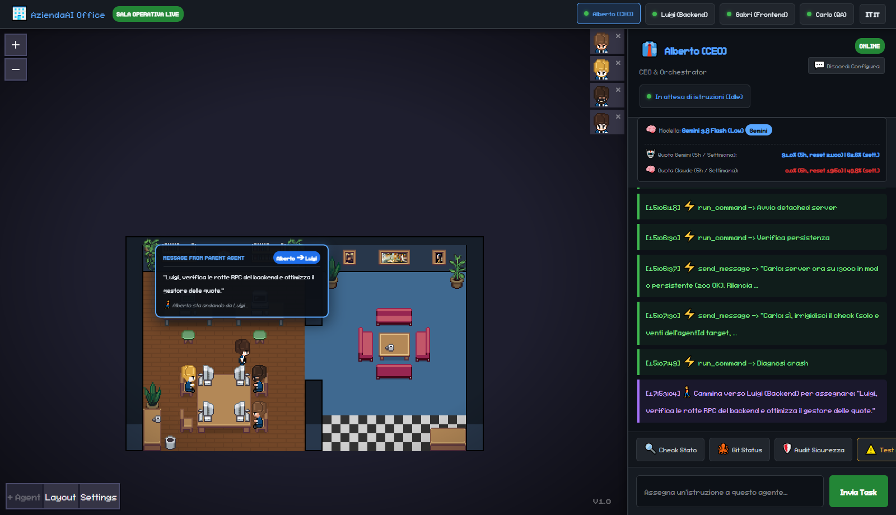
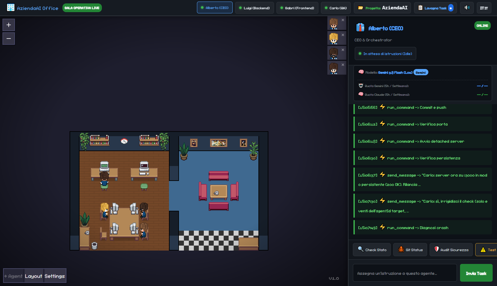

<div align="center">

# 🏢 AziendaAI — Autonomous Multi-Agent Sala Operativa for Google Antigravity

<p align="center">
  <strong>Una Sala Operativa 2D in tempo reale che trasforma i subagenti di Google Antigravity in un vero team aziendale, con delega fisica tra scrivanie, auto-failover Gemini ⇄ Claude e controllo totale da Discord.</strong>
</p>

<p align="center">
  <a href="./README.md">🇬🇧 <strong>Read in English (Default)</strong></a> • 🇮🇹 <strong>Versione Italiana</strong>
</p>

[](https://nodejs.org/)
[](#)
[](#)
[](https://discord.com/)
[](./LICENSE)

<br/>

### 🖥️ La Nostra Sala Operativa Live (`http://localhost:3000`)
*In alto i 4 membri del team (Alberto CEO, Luigi Backend, Gabri Frontend, Carlo QA), al centro l'ufficio 2D in cui gli agenti camminano fisicamente per consegnarsi i task, e a destra il Drawer Operativo con telemetria live delle quote 5h/Settimanali e log in tempo reale.*



</div>

---

## 💡 Perché è nato AziendaAI (Il Contesto)

Quando si lavora con **Google Antigravity** su progetti complessi, gestire più subagenti in parallelo presenta tre grandi limiti pratici:
1. **Invisibilità operativa**: i subagenti lavorano dietro le quinte nei file `.jsonl` del `brain`, senza una vista unica che mostri chi sta facendo cosa o quando il CEO delega un'attività a uno specialista.
2. **Blocco improvviso per esaurimento Quota 5h (`RESOURCE_EXHAUSTED`)**: quando finisce la quota 5h di **Gemini**, il team si ferma anche se hai ancora il 100% della quota **Claude** disponibile (o viceversa), perché Antigravity vincola il modello di ogni subagente al momento della creazione.
3. **Controllo da remoto assente**: se sei lontano dal PC, non puoi assegnare task ai tuoi agenti, vedere a che punto sono o autorizzare un comando critico dal telefono.

**AziendaAI risolve tutti e tre i problemi in un'unica piattaforma locale:**
- Prende il renderer canvas 2D isometrico open-source (*Pixel Agents*) e ci costruisce attorno un **server Node.js + WebSocket + Connect-RPC** interamente progettato per **Google Antigravity**.
- Introduce la **Delega Fisica con Popup (`📨 Message from Parent Agent`)**: quando **Alberto (CEO)** assegna un compito a **Luigi (Backend)**, **Gabri (Frontend)** o **Carlo (QA)**, si alza dalla sua scrivania, cammina lungo l'ufficio fino alla postazione del collega e gli consegna il messaggio!
- Interroga ogni 15 secondi il demone locale di Antigravity (`RetrieveUserQuotaSummary`) per leggere le **quote reali a 5 ore e settimanali** di Gemini e Claude, **scambiando automaticamente in background i subagenti Gemini con i loro Alterego Claude** quando la quota scende sotto il 2%.

---

## 📸 Come Funziona nel Nostro Localhost

### 1. Vista Generale della Sala Operativa


Nella barra laterale destra (**Drawer Operativo**) hai sempre sotto controllo:
- **Modello Attivo & Badge Chi Sta Rispondendo**: indica se l'agente sta usando il profilo primario **Gemini** (`#58a6ff`) oppure l'**Alterego Claude** (`#bc8cff`).
- **Telemetria Unificata Quote Antigravity**:
  - `🤖 Quota Gemini (5h / Settimana)`: es. `93.2% (5h, reset 21:00) | 63.2% (sett.)`
  - `🧠 Quota Claude (5h / Settimana)`: es. `0.0% (5h, reset 19:50) | 49.8% (sett.)`
- **Stream Live delle Azioni**: ogni tool invocato dall'agente (`run_command`, `edit_file`, `send_message`) e ogni risposta finale compaiono in diretta nella console dell'agente selezionato.
- **Quick Actions & Input Diretto**: pulsanti rapidi (`🔍 Check Stato`, `🐙 Git Status`, `🛡️ Audit Sicurezza`, `🚶‍♂️ Test Delegacy Alberto→Luigi`, `☕ Pausa Divano`, `📢 Convoca Riunione`, `📊 Report CEO`) e barra di testo per assegnare task immediati.

### 2. Le 6 Innovazioni Esclusive della Sala Operativa
- **☕ Pausa Caffè / Divano Fisica in Sala Relax (`☕ Pausa Divano`)**: Quando il team entra in modalità `rest` (quota 0%), resta inattivo per oltre 5 minuti o premi `☕ Pausa Divano`, tutti e 4 gli agenti si alzano dalle scrivanie, camminano nella sala relax a destra e si siedono sui 4 divani attorno al tavolino del caffè, tornando immediatamente ai PC appena arriva un nuovo task!
- **📢 Riunione Generale / Standup Meeting (`📢 Convoca Riunione`)**: Chiama a raccolta Luigi (`6`), Gabri (`7`) e Carlo (`8`) attorno alla scrivania di Alberto (CEO, `10`) per un briefing di allineamento sprint con fumetto live.
- **📋 Lavagna Kanban Operativa a 3 Colonne (`📋 Lavagna Task`)**: Clicca il pulsante nella Topbar per aprire la lavagna Kanban sincronizzata in tempo reale via WebSocket (`⏳ In Coda / Riposo`, `⚡ In Corso / Assegnati`, `✅ Completati`).
- **📂 Selettore Progetto Target Multi-Workspace (`📂 Progetto: ...` & `!project <percorso>`)**: Cambia in qualsiasi momento la cartella/repository su cui lavorano Alberto, Luigi, Gabri e Carlo sia dalla Topbar Web sia da Discord (`!project C:\percorso\progetto`).
- **🔊 Motore Audio Retro 8-Bit Sintetizzato (`🔊 / 🔇`)**: Sintetizzatore chiptune WebAudio API (zero file esterni) con effetti sonori 8-bit dedicati per delega task, completamento, richiesta permessi, riunione standup e pausa divano.
- **📊 Report Esecutivo CEO in 1-Click (`📊 Report CEO`)**: Genera istantaneamente un report direzionale in Markdown (progetto attivo, quote Gemini/Claude, stato del team, task Kanban completati e ultimi commit Git) copiabile o pubblicabile con 1 click in `#📢-sala-operativa` su Discord.

---

## 🔄 Macchina a 3 Stati: Auto-Failover Gemini ⇄ Claude ⇄ Riposo

```
                 ┌────────────────────────────────────────────────────────┐
                 │           👑 UTENTE / ENTITÀ SUPREMA (Web / Discord)   │
                 └───────────────────────────┬────────────────────────────┘
                                             │ Task / Prompt / Comando
                                             ▼
                 ┌────────────────────────────────────────────────────────┐
                 │          🧠 ROUTING ENGINE & QUOTA TELEMETRY           │
                 │   Connect-RPC ➔ RetrieveUserQuotaSummary (ogni 15s)    │
                 └───────┬───────────────────┬────────────────────┬───────┘
                         │                   │                    │
        Gemini 5h >= 2%  │   Gemini < 2%     │    Entrambi < 2%   │
                         ▼   Claude >= 2%    ▼                    ▼
          ┌──────────────────────┐  ┌──────────────────────┐  ┌─────────────────────────┐
          │ 🤖 MODE: GEMINI      │  │ 🧠 MODE: CLAUDE      │  │ 💤 MODE: REST (RIPOSO)  │
          │ 4 Agenti Primari     │  │ 4 Alterego Claude    │  │ Salva Task in Coda e    │
          │ (Gemini Flash / Pro) │  │ (Claude Sonnet 5.5)  │  │ Auto-Esegue al Reset    │
          └──────────┬───────────┘  └──────────┬───────────┘  └─────────────────────────┘
                     └───────────────┬─────────┘
                                     ▼
          ┌───────────────────────────────────────────────────────────────┐
          │ 👔 Alberto (CEO)  ──🚶‍♂️ cammina──►  ⚙️ Luigi / 🎨 Gabri / 🛡️ Carlo │
          └───────────────────────────────────────────────────────────────┘
```

1. **🤖 Modalità Primario (`gemini`)**: finché la quota 5h di Gemini è `>= 2%`, rispondono i 4 agenti primari Gemini.
2. **🧠 Modalità Alterego (`claude`)**: se Gemini scende sotto il `2%` (e Claude ha quota `>= 2%`), il router dirotta automaticamente ogni messaggio verso i **4 subagenti Alterego Claude** già pronti. Tu continui a scrivere negli stessi canali Web e Discord senza accorgerti di nulla! Appena Gemini torna `>= 5%`, rientrano i primari.
3. **💤 Modalità Riposo con Coda Automatica (`rest`)**: se sia Gemini che Claude sono al `0%`, il bot invia un avviso completo in `#📢-sala-operativa` indicando sia l'orario di reset di Gemini sia quello di Claude. Se mandi comunque dei compiti mentre dormono, **AziendaAI li salva in coda (`restQueue`) e li spedisce da solo agli agenti nel secondo esatto in cui scatta il reset della quota!**

---

## 👥 Il Team Predefinito (4 Agenti + 4 Alterego)

Di default AziendaAI configura una squadra software completa di **4 specialisti** (più i **4 Alterego Claude**):

| ID | Agente | Ruolo | Canale Discord | Compiti Principali |
| :---: | :--- | :--- | :--- | :--- |
| **`10`** | **👔 Alberto (CEO)** | CEO & Orchestrator *(Team Lead)* | `#👔-alberto-ceo` | Riceve le direttive generali, pianifica il lavoro, cammina verso le scrivanie dei colleghi per delegare i task e approva i rilasci. |
| **`6`** | **⚙️ Luigi (Backend)** | Backend & Systems Engineer | `#⚙️-luigi-backend` | Sviluppa server Node.js, API, WebSocket, logica Connect-RPC, script di automazione e gestione dati. |
| **`7`** | **🎨 Gabri (Frontend)** | Frontend Architect & UI Dev | `#🎨-gabri-frontend` | Cura la Dashboard Web, il Canvas 2D, i popup animati, il CSS e l'esperienza utente. |
| **`8`** | **🛡️ Carlo (QA)** | Security Auditor & Code Revisor | `#🛡️-carlo-qa` | Opera in modalità Read-Only: controlla la sicurezza del codice, verifica l'assenza di dati sensibili e valida i test prima del push. |

---

## 🚀 Installazione & Avvio in 1-Click (Per chiunque cloni la repo)

### 1. Prerequisiti
- **Windows 10/11** con **Node.js `v18+`**.
- **Google Antigravity** installato e aperto sul PC.

### 2. Clona e Installa
```bash
git clone https://github.com/nev3rquit/pixel-agents-antigravity.git
cd pixel-agents-antigravity
npm install
```

### 3. Crea i Tuoi Agenti Locali in 1-Click (`node setup-agents.js`)
Ogni installazione di Antigravity usa ID conversazione (`UUID`) generati localmente sul proprio PC. Ti basta lanciare **una sola volta**:
```bash
node setup-agents.js
```
Lo script contatta automaticamente il `language_server` locale di Antigravity, crea i tuoi **4 Agenti Primari (Gemini)** + i **4 Alterego (Claude)** secondo le specifiche di [`team.config.json`](./team.config.json) e salva i tuoi UUID nel file locale `agents.config.json` (protetto da `.gitignore`).

Se il tuo piano Antigravity non include i modelli di `team.config.json`, lo script elenca quelli disponibili; puoi sovrascriverli ad es. con `ALTEREGO_MODEL=claude-sonnet-4-6 node setup-agents.js` (anche `PRIMARY_MODEL`).

### 4. Avvia Senza Finestre CMD (`start.vbs`)
Fai **doppio click su `start.vbs`**:
- Il server parte in background in modalità completamente invisibile (nessuna finestra del prompt dei comandi aperta).
- Si apre automaticamente il browser su 👉 **`http://localhost:3000`**.

**Linux / macOS:** usa invece `./start.sh` (`./start.sh --headless` non apre il browser; i log finiscono in `server.log`).

> ⚠️ **macOS non è testato.** Su macOS la dashboard dovrebbe funzionare, ma l'eseguibile `language_server` di Antigravity non viene rilevato automaticamente: imposta `ANTIGRAVITY_LS_PATH` con il suo percorso all'interno dell'app bundle.

L'eseguibile `language_server` di Antigravity viene rilevato automaticamente (cartelle di installazione standard, launcher `antigravity` nel `PATH` oppure, su Linux, il processo di Antigravity in esecuzione). Per installazioni non standard (es. tarball estratto) indicalo esplicitamente:
```bash
export ANTIGRAVITY_HOME=/percorso/Antigravity-x64   # cartella che contiene resources/bin/
# oppure: export ANTIGRAVITY_LS_PATH=/percorso/resources/bin/language_server
```

---

## 🎨 Come Personalizzare il Team (`team.config.json`)

Vuoi cambiare i nomi dei 4 agenti, cambiare i loro ruoli/prompt, cambiare i vestiti pixel-art oppure **avere 2, 3, 5 o 6 agenti invece di 4**?
Ti basta modificare il file [**`team.config.json`**](./team.config.json)!

```json
[
  {
    "id": 10,
    "key": "alberto-ceo",
    "channelKeyword": "alberto",
    "name": "Alberto (CEO)",
    "role": "CEO & Orchestrator",
    "avatar": "👔",
    "color": 5809919,
    "palette": 3,
    "hueShift": 0,
    "seatId": "f-1773356768339-eo6u",
    "isTeamLead": true,
    "model": "flash",
    "alteregoModel": "claude-sonnet-5-5-medium",
    "systemPrompt": "Sei Alberto, CEO di AziendaAI. Coordini Luigi (Backend), Gabri (Frontend) e Carlo (QA)."
  }
]
```

- **Per cambiare nomi, ruoli o prompt**: modifica i campi `name`, `role`, `avatar`, `systemPrompt` in `team.config.json` e rilancia `node setup-agents.js`.
- **Per cambiare l'aspetto fisico dei personaggi**: cambia `palette` (da `0` a `5`) e `hueShift` (da `0` a `360` gradi per ricolorare abiti e capelli).
- **Per aggiungere o togliere agenti**: aggiungi o rimuovi blocchi nell'array di `team.config.json` e rilancia `node setup-agents.js`. Sia la Dashboard Web che il Bot Discord e il Server caricheranno automaticamente il nuovo numero di agenti!

---

## 💬 Configurazione Discord Bot (Opzionale)

Per controllare il tuo ufficio anche da Discord (da PC o smartphone):

1. Rinomina [`discord.config.example.json`](./discord.config.example.json) in **`discord.config.json`** e inserisci il token del tuo bot:
   ```json
   {
     "webhookUrl": "https://discord.com/api/webhooks/IL_TUO_WEBHOOK_URL",
     "botToken": "IL_TUO_DISCORD_BOT_TOKEN",
     "enabled": true
   }
   ```
2. Attiva **Message Content Intent** nel [Discord Developer Portal](https://discord.com/developers/applications).
3. Crea nel tuo server Discord i canali:
   - `#📢-sala-operativa` *(annunci automatici cambio modello Gemini/Claude/Riposo con orari di reset)*
   - `#📊-monitor-usage` *(pannello live auto-aggiornato con le barre delle quote 5h e settimanali)*
   - `#👔-alberto-ceo`, `#⚙️-luigi-backend`, `#🎨-gabri-frontend`, `#🛡️-carlo-qa` *(canali operativi per assegnare task a ogni singolo agente e approvare/rifiutare permessi con i bottoni interattivi)*.

---

## 🛡️ Sicurezza & Privacy

- **Zero Dati Personali nel Repository**: `discord.config.json`, `agents.config.json`, `tasks_queue.json` e tutti i file `.jsonl` sono esclusi tramite [`.gitignore`](./.gitignore).
- **Isolamento Cartella `brain`**: i log di Antigravity (`~/.gemini/antigravity/brain`) vengono letti solo localmente dal tuo PC e non vengono mai salvati nella cartella del progetto.
- **Whitelist Esecuzione**: i comandi rapidi sono filtrati da una whitelist sicura e separati dall'invio dei prompt ad `agentapi`.

---

## 📜 Crediti & Licenza

Distribuito sotto licenza **[MIT](./LICENSE)**.

- **Ideazione, Architettura Multi-Agente Antigravity, Telemetria Connect-RPC, Failover Gemini ⇄ Claude, Delega Fisica & Discord Bot**: sviluppati da **[@nev3rquit](https://github.com/nev3rquit)**.
- **Renderer 2D Canvas Base**: basato sul motore open-source di [Pixel Agents](https://github.com/pablodelucca/pixel-agents) (*Pablo De Lucca*, MIT License).
- **Tileset Grafico**: *Office Interior Tileset (16x16)* di [Donarg](https://donarg.itch.io/officetileset).
