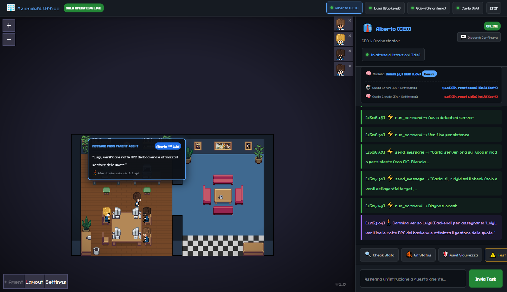
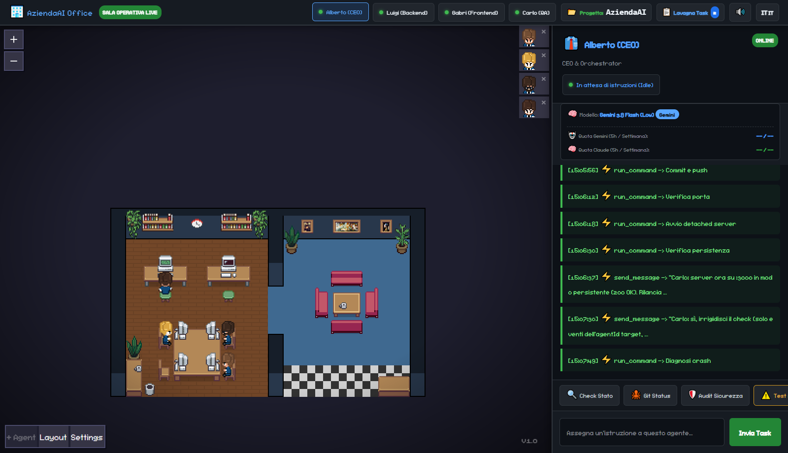

<div align="center">

# 🏢 AziendaAI — Autonomous Multi-Agent Virtual Office for Google Antigravity

<p align="center">
  <strong>A real-time 2D Pixel-Art Operations Room that turns Google Antigravity subagents into an autonomous software company — featuring physical desk-to-desk task delegation, automatic Gemini ⇄ Claude quota failover, and two-way Discord control.</strong>
</p>

<p align="center">
  🇬🇧 <strong>English (Default)</strong> • <a href="./README.it.md">🇮🇹 <strong>Leggi in Italiano</strong></a>
</p>

[](https://nodejs.org/)
[](#)
[](#)
[](https://discord.com/)
[](./LICENSE)

<br/>

### 🖥️ Live Operations Room (`http://localhost:3000`)
*Top bar with the 4 team members (Alberto CEO, Luigi Backend, Gabri Frontend, Carlo QA), central 2D office where agents physically walk across the room to delegate tasks, and right-hand Operations Drawer with live 5h/Weekly quota telemetry and real-time logs.*



</div>

---

## 💡 Why We Built AziendaAI (The Context)

When orchestrating multiple subagents in **Google Antigravity** on complex software projects, developers face three major bottlenecks:
1. **Zero Visual Visibility**: Subagents run silently in background `.jsonl` transcripts inside `~/.gemini/antigravity/brain`, with no unified dashboard showing who is working, what tool they are running, or when the Lead Agent delegates a task to a specialist.
2. **Sudden 5-Hour Quota Lockouts (`RESOURCE_EXHAUSTED`)**: When your **Gemini** 5-hour quota hits `0%`, your entire subagent team stops working—even if you still have `100%` of your **Claude** quota available (or vice versa), because Antigravity locks a subagent's model at creation time.
3. **No Remote Command & Approval**: When you are away from your desk, you cannot dispatch tasks to your agents, monitor their progress, or approve/reject critical shell commands from your phone.

**AziendaAI solves all three problems in a single standalone local server:**
- Built around an isometric 60 FPS 2D Canvas engine (*Pixel Agents*), powered by a custom **Node.js + WebSocket + Connect-RPC backend** engineered specifically for **Google Antigravity**.
- **Physical Task Delegation (`📨 Message from Parent Agent`)**: Whenever **Alberto (CEO)** assigns a task to **Luigi (Backend)**, **Gabri (Frontend)**, or **Carlo (QA)**, he stands up from his desk, walks across the office to his colleague's workstation, and delivers the prompt in a live floating speech bubble!
- **Real-Time Quota Telemetry & Auto-Failover**: Polls Antigravity's local daemon (`RetrieveUserQuotaSummary`) every 15 seconds to track real **5-hour and Weekly quotas** for both Gemini and Claude, **seamlessly switching between Primary (Gemini) and Alterego (Claude) subagents** when quota drops below `2%`.

---

## 📸 How It Works on Localhost

### 1. Full Operations Dashboard View


In the right-hand **Operations Drawer**, you get instant visibility into:
- **Active Model & Responder Badge**: Shows whether the agent is currently running on its primary **Gemini** profile (`#58a6ff`) or its **Claude Alterego** (`#bc8cff`).
- **Unified Antigravity Quota Telemetry**:
  - `🤖 Gemini Quota (5h / Weekly)`: e.g. `93.2% (5h, reset 21:00) | 63.2% (weekly)`
  - `🧠 Claude Quota (5h / Weekly)`: e.g. `0.0% (5h, reset 19:50) | 49.8% (weekly)`
- **Live Action Stream**: Every tool call (`run_command`, `edit_file`, `send_message`) and final response streams live into the selected agent's console.
- **Quick Actions & Direct Prompting**: One-click buttons (`🔍 Check Status`, `🐙 Git Status`, `🛡️ Security Audit`, `🚶‍♂️ Test Delegation Alberto→Luigi`, `☕ Sofa Break`, `📢 Call Standup Meeting`, `📊 CEO Report`) plus a direct task input bar.

### 2. Built-in Virtual Office Innovations
- **☕ Physical Sofa / Coffee Break Mode (`☕ Sofa Break`)**: When the team enters `rest` mode (0% quota), stays inactive for >5 minutes, or when you click `☕ Sofa Break`, all 4 agents stand up from their desks, walk into the right-hand lounge room, and sit on the 4 sofas around the coffee table—automatically returning to their workstations the instant a new task arrives!
- **📢 All-Hands Standup Meeting (`📢 Call Standup Meeting`)**: Summons Luigi (`6`), Gabri (`7`), and Carlo (`8`) to walk over and gather around Alberto (CEO, `10`)'s desk for a synchronized sprint alignment huddle with a live speech bubble.
- **📋 Live 3-Column Kanban Task Board (`📋 Task Board`)**: Click the Topbar badge to open a real-time Kanban modal synced via WebSocket (`⏳ Queued / Rest`, `⚡ In Progress / Dispatched`, `✅ Completed`).
- **📂 Multi-Workspace Target Project Switcher (`📂 Workspace: ...` & `!project <path>`)**: Switch the active target directory from the Web Topbar or from Discord (`!project C:\path\to\repo`) so your team can work on any codebase on your machine.
- **🔊 Synthesized 8-Bit Retro Audio Engine (`🔊 / 🔇`)**: Zero-dependency WebAudio API chiptune synthesizer playing subtle 8-bit chimes on task delegation, completion, permission alerts, standup meetings, and sofa breaks.
- **📊 1-Click CEO Executive Report (`📊 CEO Report`)**: Generates a full Markdown executive summary (active workspace, Gemini/Claude quotas, team status, Kanban stats, and latest Git commits) with 1-click copy or direct broadcast to `#📢-sala-operativa` on Discord.

---

## 🔄 3-State Machine: Gemini ⇄ Claude ⇄ Rest Auto-Failover

```
                 ┌────────────────────────────────────────────────────────┐
                 │             👑 USER / SUPREME ENTITY (Web / Discord)   │
                 └───────────────────────────┬────────────────────────────┘
                                             │ Task / Prompt / Command
                                             ▼
                 ┌────────────────────────────────────────────────────────┐
                 │          🧠 ROUTING ENGINE & QUOTA TELEMETRY           │
                 │   Connect-RPC ➔ RetrieveUserQuotaSummary (every 15s)   │
                 └───────┬───────────────────┬────────────────────┬───────┘
                         │                   │                    │
        Gemini 5h >= 2%  │   Gemini < 2%     │     Both < 2%      │
                         ▼   Claude >= 2%    ▼                    ▼
          ┌──────────────────────┐  ┌──────────────────────┐  ┌─────────────────────────┐
          │ 🤖 MODE: GEMINI      │  │ 🧠 MODE: CLAUDE      │  │ 💤 MODE: REST (SLEEP)   │
          │ 4 Primary Agents     │  │ 4 Claude Alteregos   │  │ Queues Tasks & Auto-    │
          │ (Gemini Flash / Pro) │  │ (Claude Sonnet 5.5)  │  │ Dispatches at Reset!    │
          └──────────┬───────────┘  └──────────┬───────────┘  └─────────────────────────┘
                     └───────────────┬─────────┘
                                     ▼
          ┌───────────────────────────────────────────────────────────────┐
          │ 👔 Alberto (CEO)  ──🚶‍♂️ walks to──►  ⚙️ Luigi / 🎨 Gabri / 🛡️ Carlo │
          └───────────────────────────────────────────────────────────────┘
```

1. **🤖 Primary Mode (`gemini`)**: As long as Gemini's 5h quota is `>= 2%`, tasks are routed to the 4 primary Gemini agents.
2. **🧠 Alterego Mode (`claude`)**: If Gemini's 5h quota drops below `2%` (and Claude has `>= 2%` quota), the router transparently switches all channels to the **4 pre-spawned Claude Alterego subagents**. You keep chatting in the exact same Web drawer and Discord channels! As soon as Gemini recovers to `>= 5%`, it switches back.
3. **💤 Rest Mode with Auto-Wakeup Queue (`rest`)**: If both Gemini and Claude hit `0%`, the bot posts a full status embed in `#📢-sala-operativa` showing the exact reset times for both Gemini and Claude. Any task you send while they rest is **saved in `restQueue` and automatically executed the exact second quota resets!**

---

## 👥 The Default Team (4 Primary Agents + 4 Alteregos)

Out of the box, AziendaAI sets up a balanced 4-agent software engineering team (plus their **4 Claude Alteregos**):

| ID | Agent | Role | Discord Channel | Core Responsibilities |
| :---: | :--- | :--- | :--- | :--- |
| **`10`** | **👔 Alberto (CEO)** | CEO & Orchestrator *(Team Lead)* | `#👔-alberto-ceo` | Receives high-level goals, plans architecture, physically walks to colleagues' desks to delegate tasks, and approves releases. |
| **`6`** | **⚙️ Luigi (Backend)** | Backend & Systems Engineer | `#⚙️-luigi-backend` | Builds Node.js servers, APIs, WebSockets, Connect-RPC integrations, and automation scripts. |
| **`7`** | **🎨 Gabri (Frontend)** | Frontend Architect & UI Dev | `#🎨-gabri-frontend` | Designs the Web Dashboard, 2D Canvas animations, floating popups, CSS styling, and UX. |
| **`8`** | **🛡️ Carlo (QA)** | Security Auditor & Code Revisor | `#🛡️-carlo-qa` | Operates in strict Read-Only mode: performs code reviews, zero-leak security audits, and end-to-end verification before pushes. |

---

## 🚀 1-Click Quick Start (For Any PC)

### 1. Prerequisites
- **Windows 10/11** with **Node.js `v18+`**.
- **Google Antigravity** installed and running on your machine.

### 2. Clone & Install
```bash
git clone https://github.com/nev3rquit/pixel-agents-antigravity.git
cd pixel-agents-antigravity
npm install
```

### 3. Spawn Your Local Agents in 1-Click (`node setup-agents.js`)
Because every Antigravity installation uses local conversation `UUIDs` on your machine, run this **once**:
```bash
node setup-agents.js
```
This script automatically talks to your local Antigravity `language_server`, creates your **4 Primary Agents (Gemini)** + **4 Alterego Agents (Claude)** based on [`team.config.json`](./team.config.json), and writes your private UUIDs to `agents.config.json` (gitignored).

If your Antigravity plan doesn't include the models in `team.config.json`, the script lists the ones you have; override them with e.g. `ALTEREGO_MODEL=claude-sonnet-4-6 node setup-agents.js` (also `PRIMARY_MODEL`).

### 4. Launch Headless (`start.vbs`)
Double-click **`start.vbs`**:
- Starts the Node.js server silently in the background (**zero open CMD windows**).
- Automatically opens your browser to 👉 **`http://localhost:3000`**.

**Linux / macOS:** run `./start.sh` instead (`./start.sh --headless` skips opening the browser; logs go to `server.log`).

> ⚠️ **macOS is untested.** On macOS the dashboard should run, but the Antigravity `language_server` binary is not auto-detected: set `ANTIGRAVITY_LS_PATH` to its location inside the app bundle.

The Antigravity `language_server` binary is auto-detected (standard install dirs, the `antigravity` launcher on your `PATH`, or the running Antigravity process on Linux). For a non-standard install (e.g. an extracted tarball), point to it explicitly:
```bash
export ANTIGRAVITY_HOME=/path/to/Antigravity-x64   # folder containing resources/bin/
# or: export ANTIGRAVITY_LS_PATH=/path/to/resources/bin/language_server
```

---

## 🎨 Customizing Your Team (`team.config.json`)

Want to rename the 4 agents, change their roles/prompts, customize their pixel-art outfits, or **run 2, 3, 5, or 6 agents instead of 4**?
Simply edit [**`team.config.json`**](./team.config.json)!

```json
[
  {
    "id": 10,
    "key": "alberto-ceo",
    "channelKeyword": "alberto",
    "name": "Alberto (CEO)",
    "role": "CEO & Orchestrator",
    "avatar": "👔",
    "color": 5809919,
    "palette": 3,
    "hueShift": 0,
    "seatId": "f-1773356768339-eo6u",
    "isTeamLead": true,
    "model": "flash",
    "alteregoModel": "claude-sonnet-5-5-medium",
    "systemPrompt": "You are Alberto, CEO of AziendaAI. Coordinate Luigi (Backend), Gabri (Frontend), and Carlo (QA)."
  }
]
```

- **Change names, roles, or prompts**: Edit `name`, `role`, `avatar`, or `systemPrompt` in `team.config.json` and re-run `node setup-agents.js`.
- **Customize pixel-art appearance**: Change `palette` (`0` to `5`) and `hueShift` (`0` to `360` degrees to shift hair/suit colors).
- **Add or remove agents**: Add or remove entries in `team.config.json` and run `node setup-agents.js`. The Web Dashboard, Server, and Discord Bot will dynamically load your custom roster!

---

## 💬 Discord Bot Integration (Optional)

Control your virtual office from anywhere via Discord:

1. Copy [`discord.config.example.json`](./discord.config.example.json) to **`discord.config.json`** and add your bot token:
   ```json
   {
     "webhookUrl": "https://discord.com/api/webhooks/YOUR_WEBHOOK_URL",
     "botToken": "YOUR_DISCORD_BOT_TOKEN",
     "enabled": true
   }
   ```
2. Enable **Message Content Intent** in the [Discord Developer Portal](https://discord.com/developers/applications).
3. Create channels in your Discord server (matched automatically by keyword):
   - `#📢-sala-operativa` *(automatic Gemini/Claude/Rest mode announcements with exact reset times)*
   - `#📊-monitor-usage` *(live auto-updating dashboard with 5h and weekly quota progress bars)*
   - `#👔-alberto-ceo`, `#⚙️-luigi-backend`, `#🎨-gabri-frontend`, `#🛡️-carlo-qa` *(direct channels to assign tasks to each agent and click `✅ Approve` / `❌ Reject` on permission prompts)*.

---

## 🛡️ Security & Privacy

- **Zero Secrets in Git**: `discord.config.json`, `agents.config.json`, `tasks_queue.json`, and all `*.jsonl` files are strictly excluded via [`.gitignore`](./.gitignore).
- **Isolated `brain` Directory**: Antigravity transcripts (`~/.gemini/antigravity/brain`) are read locally at runtime via `os.homedir()` and never copied into the repository.
- **Sandboxed Command Bridge**: Direct shell commands are restricted to a strict whitelist via `execFile` (no shell interpolation), separated from `agentapi` prompt forwarding.

---

## 📜 Credits & License

Licensed under the **[MIT License](./LICENSE)**.

- **Multi-Agent Antigravity Architecture, Connect-RPC Telemetry, Gemini ⇄ Claude Auto-Failover, Physical Delegation & Discord Gateway**: created by **[@nev3rquit](https://github.com/nev3rquit)**.
- **Base 2D Canvas Webview Engine**: built upon the open-source [Pixel Agents](https://github.com/pablodelucca/pixel-agents) renderer by *Pablo De Lucca* (MIT License).
- **Pixel Art Tileset**: *Office Interior Tileset (16x16)* by [Donarg](https://donarg.itch.io/officetileset).

---

<div align="center">
  <sub>If you find this project useful, please consider giving it a ⭐ on GitHub!</sub>
</div>
